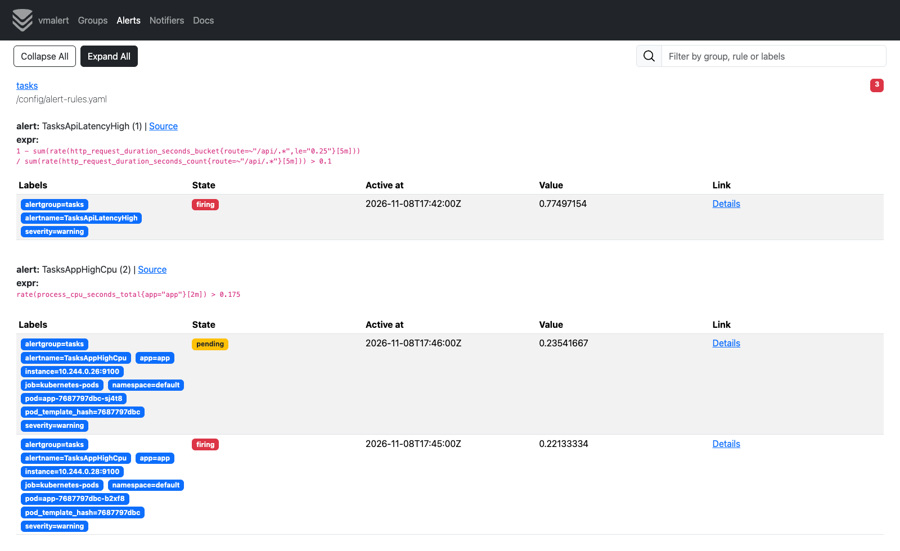
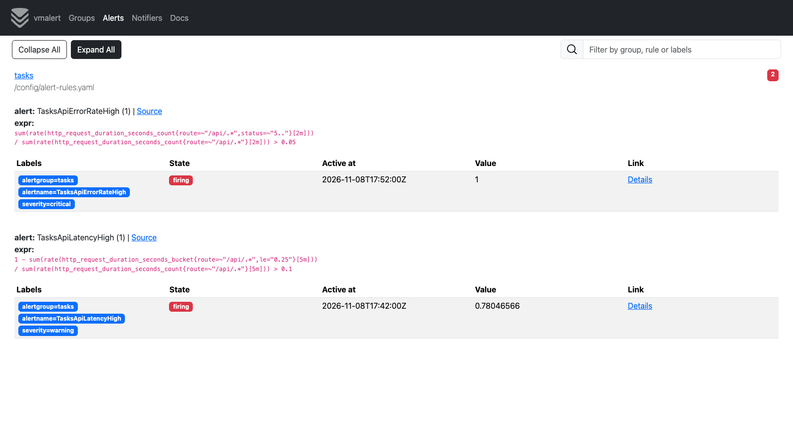
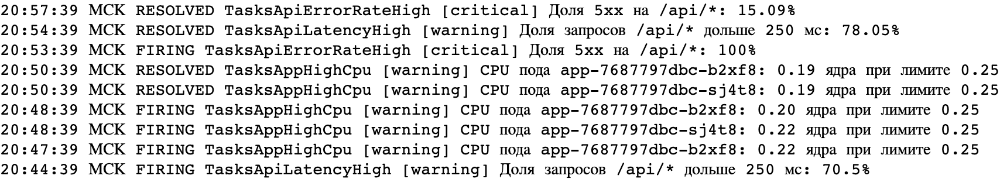

# Отчет

Репозиторий: https://github.com/Tsynskyy/sre-2026-2027/tree/hw6

Алерты и Alertmanager: `k8s/monitoring/vmalert-values.yaml` для чарта `vm/victoria-metrics-alert`
Уведомления: Alertmanager шлет webhook в `alert-receiver` (`k8s/monitoring/alert-receiver.yaml`), который пишет их в лог и на страницу

## Алерты

| Алерт | Условие | Почему |
|---|---|---|
| `TasksApiErrorRateHigh`, critical | больше 5% ответов `/api/*` с 5xx за 2 минуты, `for: 1m` | пользователи получают ошибки |
| `TasksApiLatencyHigh`, warning | больше 10% запросов `/api/*` дольше 250 мс за 5 минут, `for: 2m` | сервис отвечает, поэтому warning |
| `TasksAppHighCpu`, warning | `rate(process_cpu_seconds_total{app="app"}[2m]) > 0.175`, `for: 2m` | рантайм Python: 70% лимита 250m, дальше троттлинг |

## Срабатывание

08.11, МСК: нагрузка 60 потоков `GET /api/tasks`, затем остановка БД `kubectl scale sts db --replicas=0`
vmalert показывает время в UTC

