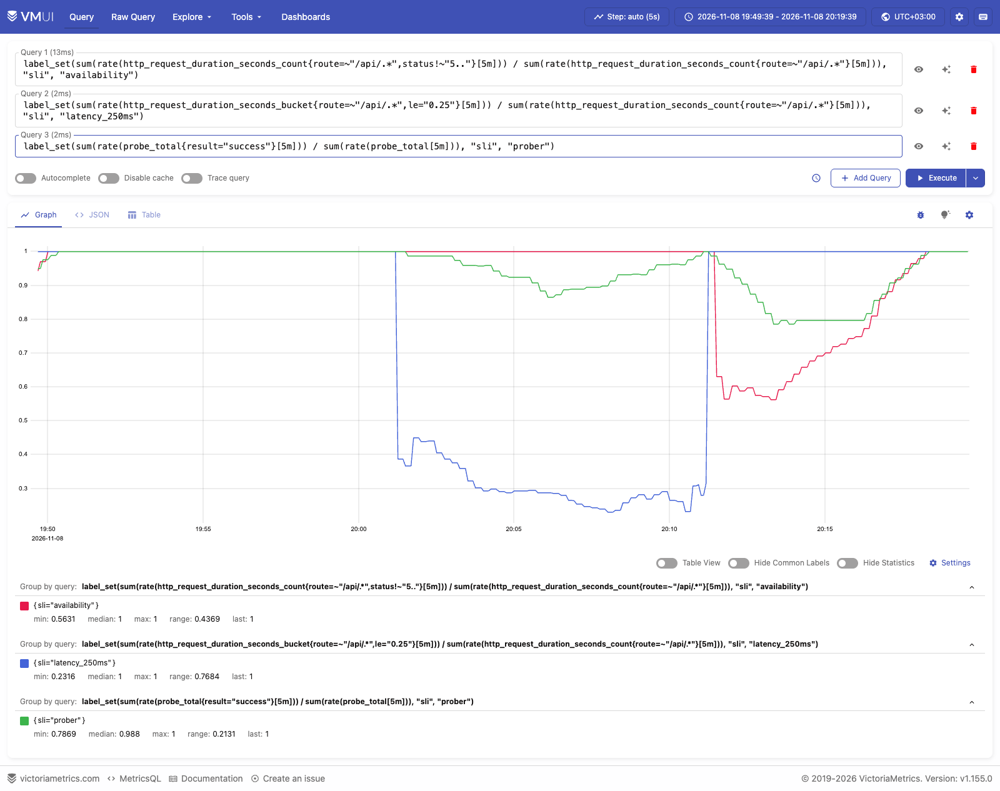
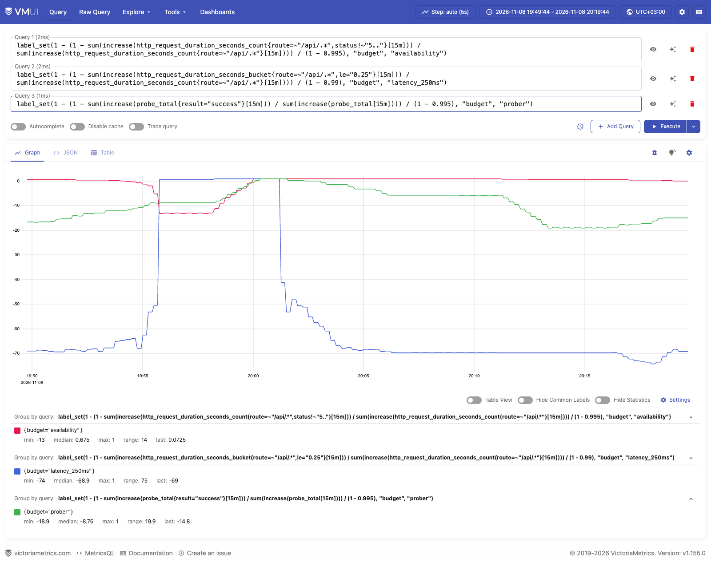
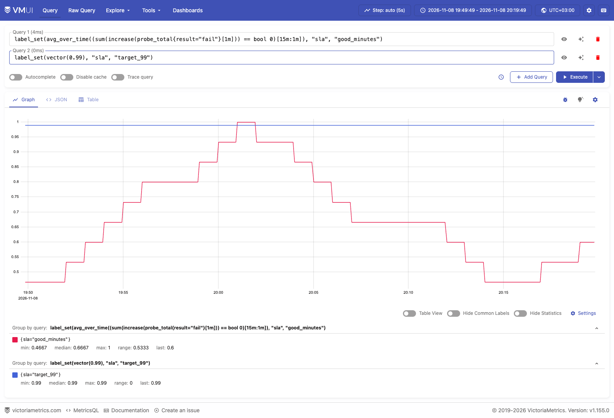

# Отчет

Репозиторий: https://github.com/Tsynskyy/sre-2026-2027/tree/hw5

## Метрики

- `http_request_duration_seconds_count{route, status}` - число ответов приложения по маршруту и коду
- `http_request_duration_seconds_bucket{route, status, le}` - распределение времени ответа
- `probe_total{check, result}` - шаги пробера `prober.py`: раз в 10 секунд он создает, закрывает и удаляет задачу через Service `app`

## SLI

| SLI | Формула |
|---|---|
| Доступность | ответы `/api/*` не 5xx / все ответы `/api/*` |
| Латентность | ответы `/api/*` до 250 мс / все ответы `/api/*` |
| Пробер | успешные шаги / все шаги |

```
sum(rate(http_request_duration_seconds_count{route=~"/api/.*",status!~"5.."}[5m])) / sum(rate(http_request_duration_seconds_count{route=~"/api/.*"}[5m]))
sum(rate(http_request_duration_seconds_bucket{route=~"/api/.*",le="0.25"}[5m])) / sum(rate(http_request_duration_seconds_count{route=~"/api/.*"}[5m]))
sum(rate(probe_total{result="success"}[5m])) / sum(rate(probe_total[5m]))
```

## SLO

За 28 дней: доступность 99.5%, латентность 99%, пробер 99.5%

Остаток бюджета ошибок: `1 - (1 - SLI) / (1 - SLO)`, SLI через `increase(...[28d])`

## SLA

Доступность за месяц не ниже 99%: доля минут без ошибок пробера

```
avg_over_time((sum(increase(probe_total{result="fail"}[1m])) == bool 0)[30d:1m])
```

## Изменения поведения приложения

- Нагрузка: 60 потоков без пауз делают `GET /api/tasks`, растет время ответа
- Отказ БД: `kubectl scale sts db --replicas=0`, через 2 минуты `--replicas=1`

## Графики

08.11, МСК: 20:01-20:06 нагрузка, 20:11-20:13 БД остановлена
Окно бюджета и SLA на графиках 15 минут вместо 28 и 30 дней






