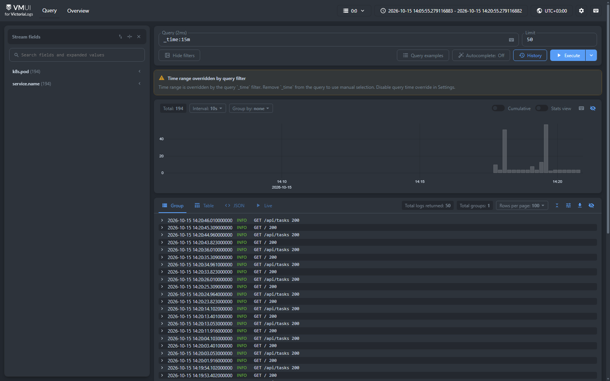
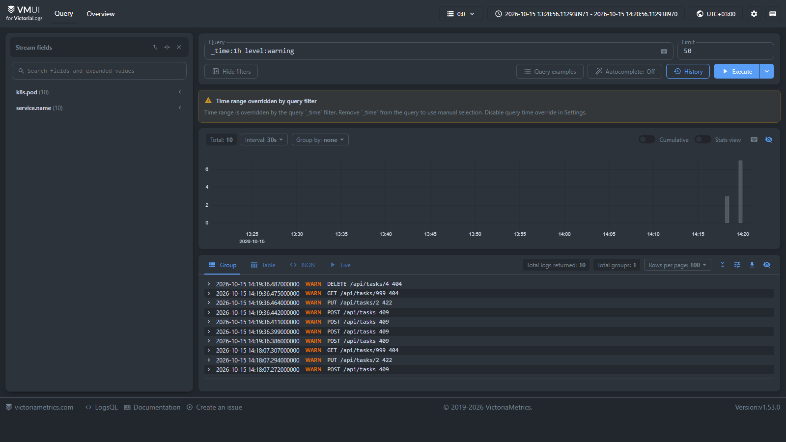
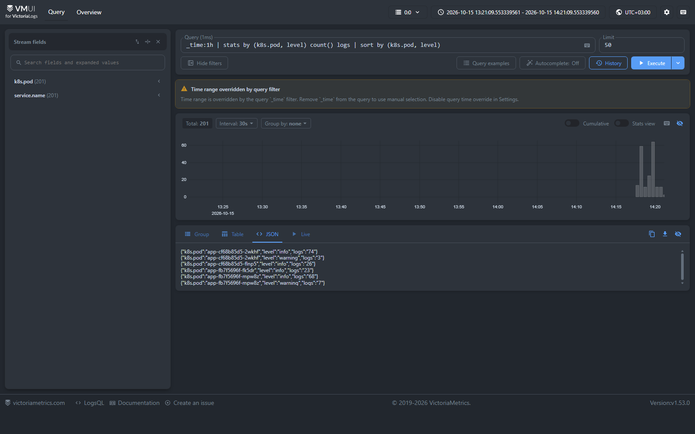
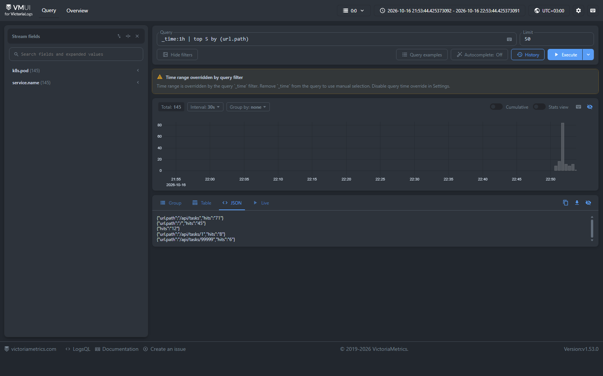

# Отчет

Репозиторий: https://github.com/Tsynskyy/sre-2026-2027/tree/hw3

## Развертывание

minikube:

```sh
kubectl apply -f k8s/victoria-logs.yaml
kubectl apply -f k8s/vector.yaml
kubectl port-forward svc/victoria-logs 9428:9428
```

vmui: http://127.0.0.1:9428/select/vmui/

- `k8s/victoria-logs.yaml` - VictoriaLogs single-node: StatefulSet с PVC 1 ГБ, хранение 7 дней, Service `victoria-logs:9428`
- `k8s/vector.yaml` - Vector: DaemonSet, ConfigMap с конфигом, ServiceAccount и права на чтение подов

## JSON логи

`app.py` пишет в stdout одну строку на запрос через стандартный `logging`:

```json
{"timestamp": "2026-10-15T08:15:02.731+00:00", "level": "info", "message": "GET /tasks 200", "service.name": "tasks", "logger": "tasks", "http.method": "GET", "url.path": "/tasks", "http.status_code": 200, "duration_ms": 3}
```

- `level`: `info` для 2xx и 3xx, `warning` для 4xx, `error` для 5xx
- при исключении добавляется поле `error`

## Доставка логов

Vector в DaemonSet читает файлы контейнеров, разбирает JSON из строки, добавляет `k8s.pod` и `k8s.node` и отправляет в VictoriaLogs через ES-bulk API `/insert/elasticsearch/`
Поле `message` становится `_msg`, `timestamp` становится `_time`, поток задается полями `service.name` и `k8s.pod`

- приложение просто пишет в stdout и не нужно добавлять библиотеки
- DaemonSet - один агент на узел для всех подов
- Vector берет метаданные пода из API Kubernetes и умеет разбирать JSON

## Запросы

### Сырые записи за последние 15 минут

```
_time:15m
```

Все записи приложения за последние 15 минут, со всеми полями JSON



### Фильтр по конкретному полю

```
_time:1h level:warning
```

Только warning ответы 4xx за час



### Stats-запрос с группировкой

```
_time:1h | stats by (k8s.pod, level) count() logs | sort by (k8s.pod, level)
```

Число записей по каждой реплике и уровню



### Агрегирующий запрос

```
_time:1h | top 5 by (url.path)
```

Пять самых частых путей за час и количество запросов к ним


