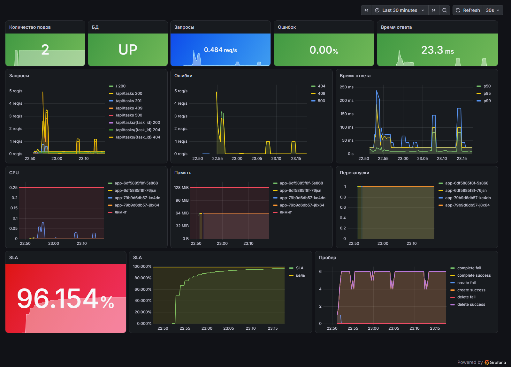
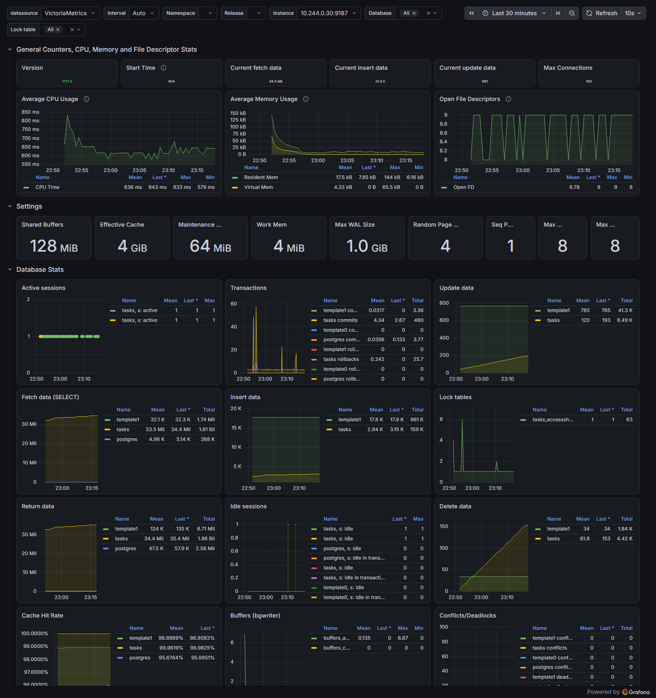

# Отчет

Репозиторий: https://github.com/Tsynskyy/sre-2026-2027/tree/hw7

Grafana: чарт `grafana-community/grafana`, значения `k8s/monitoring/grafana-values.yaml`
Дашборд приложения: `k8s/monitoring/grafana/tasks-dashboard.json`
Дашборд PostgreSQL Exporter: импорт

## Источники данных

Один источник: VictoriaMetrics single, тип Prometheus, добавлен provisioning в values
В нем метрики `app` и `prober` (`:9100`) и `postgres-exporter` (`:9187`)

## Дашборд приложения



| Блок | Панели | Метрики | Почему |
|---|---|---|---|
| Обзор | Количество подов, БД, Запросы, Ошибок, Время ответа | `up`, `pg_up`, `http_request_duration_seconds_count/_bucket` | за 5 секунд видно, живо ли приложение и его зависимость |
| | Запросы, Ошибки, Время ответа | то же по `route`, `status`, перцентили | откуда трафик, 4xx отдельно от 5xx, хвост задержки |
| Рантайм | CPU, Память, Перезапуски | `process_cpu_seconds_total`, `process_resident_memory_bytes`, `process_start_time_seconds` | утилизация относительно лимитов пода и ошибки |
| SLA пробера | SLA, SLA (график за последний час), Пробер | `probe_total{check, result}` | SLA и какой шаг сценария упал |

### SLA пробера

SLA: доступность за месяц не ниже 99%, доля минут без ошибок пробера

```
avg_over_time((sum(increase(probe_total{result="fail"}[1m])) == bool 0)[$__range:1m])
```

`$__range` - период дашборда: на месяце это SLA, на 30 минутах - текущее состояние

## Дашборд PostgreSQL Exporter

Импорт, источник данных - VictoriaMetrics



нагрузка: создание задач с повторами (409), чтение списка, запрос несуществующей задачи (404)
